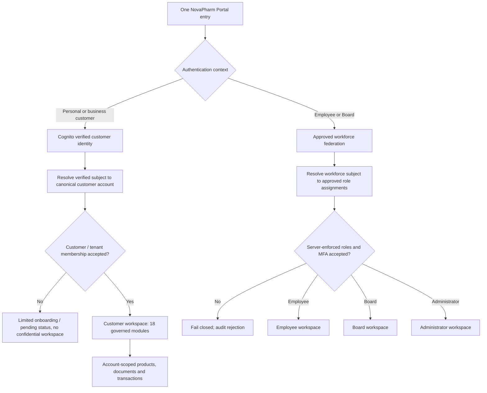
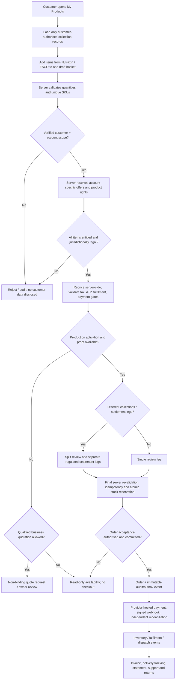
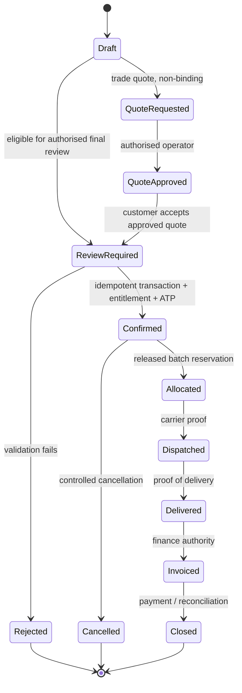

# NovaPharm: one governed customer workspace and commerce orchestrator

**Status:** Repository implementation candidate; NOT a production cutover, approved checkout, order settlement, or external licence.  
**Reviewed:** 14 November 2026.  
**Source of truth:** `packages/portal-contracts/src/module-catalog.json` (54 modules: 18 customer, 13 employee, 18 board/executive, 5 administrator; 48 currently navigation-visible and 6 gated), `src/core/enterprise-domain-service-base.mjs`, `apps/portal/data/routes.ts`.  
**Owner direction:** Do not offer a separate Nutraxin ordering application. Nutraxin and ESCO Anand are collections in **My Products** on the same authorised Customer workspace.

## 1. One platform, four strict access boundaries

| Role | Route | Governed access |
| --- | --- | --- |
| Customer | `/portal/dashboard/` | 18 Customer modules, only the linked customer/tenant's records |
| Employee | `/employee/dashboard/` | Employee workflow and assigned company scopes |
| Board | `/portal/executive-platform/` | Board intelligence, no accidental customer checkout or admin powers |
| Administrator | `/admin/dashboard/` | Audited administration and explicitly delegated privileges |

`portal.novapharmhealthcare.com` is the intended managed application origin. A corporate product page is an **editorial discovery surface**, not an independent ordering authority. Authentication may federate different identity providers, but a single identity/tenant registry and server-enforced scoped session makes the final access decision. **Do not** reuse the Nutraxin consumer Cognito session cookie as an enterprise `np_session`, infer an organisation from email, or mint customer/employee/board/admin grants by choosing a button.

### Identity and access flow

A personal consumer account is not automatically an approved trade account. Preserve the existing user's verified consumer identity pending a formally accepted identity-linking migration; avoid duplicating personally identifying data into a second ungoverned customer database.

## 2. Customer modules are the complete experience

The 18 canonical Customer modules are: Customer Dashboard, My Account, My Orders, My Invoices, My Statements, My Products, Price Lists, Stock Availability, Order Tracking, Delivery Tracking, Returns, Quality Complaints, Documents, Support Tickets, Regulatory Documents, Downloads, Customer Analytics and Settings.

**My Products** displays **account-authorised** Nutraxin and ESCO records from the same canonical product/price/stock rights views. Storefront-only code, supplier SSM provisional pricing and the ESCO public catalogue do **not** automatically confer customer prices or purchase eligibility. Public corporate product links may carry an allowlisted selection intent into the portal; they do not charge, reserve, submit or assign a tenant.

## 3. Unified basket → governed transaction, algorithm

One basket and one customer order interface can contain different collections. The server splits fulfilment/settlement *legs* when the seller, currency, licencing requirements or fulfilment agreements differ; this is **not** a licence to create unpriced or cross-provider atomic charges. Canonical customer order, legs, vendor commitments, events and statements must reconcile under one customer/tenant identity.

**Algorithms implemented in this candidate:** `src/core/unified-customer-commerce.mjs` performs a pure server-side PRE-CHECKOUT decision. It checks verified tenant identity and Customer scope, active account status, duplicate/invalid lines, account-owned offers, permitted collection/channel/market, explicit regulated authorisation, approved price/quantity, verified rights/ATP, and server-owned production/tax/fulfilment/payment gates. It returns only `access_denied`, `invalid_basket`, `blocked`, `browse_only`, `request_quote`, `split_review_required`, or `checkout_review`. **None** of these states creates an order, reserves stock, invoices or starts payment. `checkout_review` requires an idempotency key and *still* demands the transactional backend's final commit checks.

**Unimplemented release dependencies:** An approved and durable order transaction service and idempotency ledger; up-to-date Nutraxin and ESCO source rights / jurisdiction / sellable-stock mappings; tax and merchant-of-record acceptance; customer identity reconciliation; vendor-leg settlement and delivery contract; signed Stripe reconciliation and refund/return handling; tested production ingress to the governed Enterprise Portal. No new test passing in isolation satisfies these dependencies.

## 4. Order and fulfilment lifecycle

No UI-created "paid" or "delivered" claim. The server must enforce allowed transitions, tenant and approver scopes, concurrency/idempotency, audit/outbox, double-entry financial reconciliation, refund rights, and per-jurisdiction regulated restrictions. Failed payment does not equal rejected legal order; ledger transitions must be modelled explicitly.

## 5. Domain and deployment migration (not executed)

| Layer | Target | Current verified limitation |
| --- | --- | --- |
| Browser | One `portal.novapharmhealthcare.com` authenticated app | Public domain still maps to the Nutraxin staging API, not the Enterprise Next.js portal |
| Portal | `apps/portal` controlled role-scoped routes | ECS `novapharm-staging-portal-private` desired/running tasks 0/0, no public ingress |
| Customer authority | Verified subject → linked tenant/customer + scoped session | Cognito personal account is not automatically the canonical Enterprise Portal customer |
| Products / prices / stock | `customer.products`, price lists, ATP; authoritative DB | ESCO 373 references are catalogue, not 373 approved, priced, sellable SKUs |
| Commerce / ledger | One order aggregate with independently governed legs | Nutraxin and ESCO checkout APIs have separate release controls; no accepted cross-line orchestration |
| Security | HTTPS, WAF, least privilege, MFA, RBAC, tenant isolation, rate limits, audit | Full exact-SHA staging/production acceptance still pending |

### Safe cutover procedure

1. Build and validate a separate managed portal candidate with real identity, data authority and customer isolation. Never expose a synthetic demo as production.
2. Reconcile the existing verified consumer Cognito account(s) through an audited account claim/link without copying credentials or automatically granting wholesale access.
3. Demonstrate all 18 customer routes against the same linked account, including zero leakage from customer B, negative workforce/board/admin route tests, and honest unavailable states for unapproved workflows.
4. Implement the governed order write path, inventory commitments, invoicing and delivery; test stock races, retries, payment webhook replay, refund/returns, rights and VAT gating.
5. Complete role-specific E2E tests in Safari/WebKit and Chromium, backup/restore, monitoring, cost gates and production release signoff.
6. Rehearse reversible DNS/API cutover; only then transfer `portal.novapharmhealthcare.com` and retire the standalone Nutraxin ordering UI while preserving customer accounts and records.

**Non-negotiable:** no unverified regulated sale, invented customer records, external messages/emails, production payment activation, unreviewed DNS cutover, or cross-role privilege escalation.
