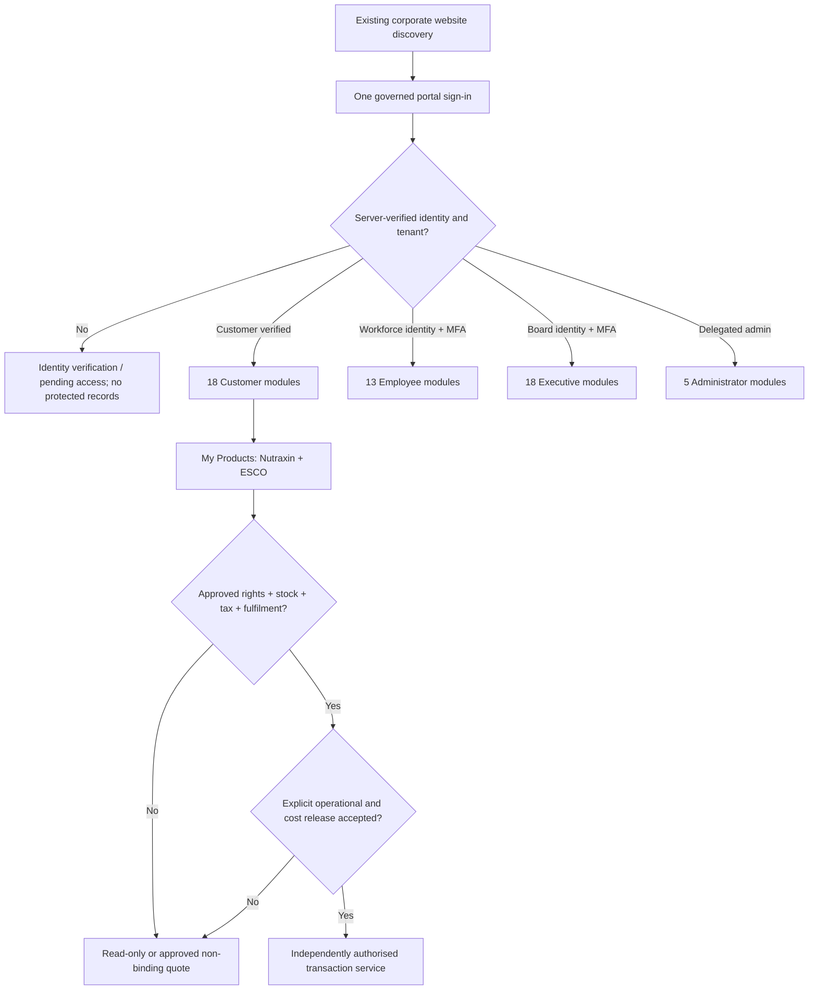

# NovaPharm unified portal — £0 additional monthly spend release plan

**Owner decision, 14 November 2026:** No additional monthly AWS/Atlas budget. Use current account services/subscriptions and the two existing Atlas FREE clusters only. Do not buy licences, upgrade database tiers, increase paid compute reservations, start new always-on services, add paid monitoring, process payments or request external services. This cap is **additional spend GBP 0**, not a statement that AWS usage is free.

**Release status:** Code for the four-role 54-module Portal has been merged; an Alpine-based staging image passed AWS CodeBuild, ECR basic scan and an isolated ECS HTTP smoke test. **NOT LIVE** at the enterprise hostname. No live tenant/role backend acceptance has occurred.

## Verified live AWS / Atlas inventory

| Component | Observed state | Can be used under £0 additional spend? |
|---|---|---|
| Public `portal.novapharmhealthcare.com` | API Gateway default mapping to existing Nutraxin customer Lambda; working consumer signup | **Preserve unchanged** until a safe, reversible enterprise cutover |
| Unified Portal Next.js | Existing ECR image, staging private ECS service desired/running `0/0`, no public listener, no tenant credentials | Source tests and brief private probes only if existing allowances cover use |
| AWS Cognito | Existing Nutraxin staging customer pool and separately configured workforce/customer pools | Reuse requires independently tested user↔tenant linkage, consent, MFA, secure callbacks and explicit cost/quota proof |
| MongoDB Atlas | Existing production and staging clusters both report `instanceType: FREE` | Use existing tier within free quotas; no automatic tier upgrade or unapproved tenant data migration |
| Existing APIs, Lambda, object storage, logs | Existing deployed resources with usage-metered operations | Reuse **only after** call/transfer/log/storage growth is proven to have £0 additional billable impact |
| GitHub repositories and deployment code | Existing source pipeline, PRs and release artifacts | Code review / source-only tests; do not infer GitHub Actions or storage quotas are unlimited |
| AWS budgets | An existing USD monthly COST alert/limit, not a GBP 0 hard block | Do not infer a budget warning prevents overruns; IAM/service quotas and external cost approval still required |

Actual Cost Explorer and AWS Budgets amounts may differ because of time windows, inclusion of credits and billing adjustments. No billing data should be made public. An observed low past charge is **not** proof that an additional ECS task, ALB, invocation, NAT gateway or storage growth will cost zero.

## Architecture decision

A single authenticated portal can share a customer-facing order basket, but cannot safely share unrelated Cognito cookies or allow Customer, Employee, Board and Admin roles to be selected from a browser. Do **not** copy Nutraxin consumer sessions into the enterprise `np_session` format. Existing customer account records and commerce evidence must survive any future migration.

## Existing-subscription-first implementation path

1. **Preserve** the current live Nutraxin signup while the secure identity bridge is built and reviewed. Keep direct customer payments and regulated ordering disabled.
2. **Complete the production-backed tenant/session API** at `/api/portal/session` with server-side identity verification, durable account links, revocation, audit, MFA and secure host-only cookies. The Next.js Portal currently requires this endpoint and fails closed without it.
3. **Map the 18 Customer module data authorities** to real account-scoped sources. Use one canonical customer record with precise document/order/invoice/statement/stock ownership. If source access is not yet approved, show honest unavailable states, not demo receipts or invented orders.
4. **Reuse existing cloud components only if a per-service cost proof is available:** measure incremental request, execution seconds, storage, logs and data transfer against the exact active plan, free credits and quota. Existing AWS infrastructure does not authorise a new always-running Portal task automatically.
5. **Prove two-tenant, four-role denial tests** with real staging claims, login/logout, abandoned and revoked sessions, bad OIDC state, provider callback, CSRF, Safari and Chromium. Validate source rights, operational data quality and backup/restore.
6. **Only with accepted release evidence and cost proof,** submit a reversible production ingress change. If any required reliable component would add cost, defer the public cutover: owner cap is GBP 0. Do not redirect to the currently running Nutraxin BFF or Intelligence catch-all.
7. **Keep commerce independent of deployment vanity metrics.** Nutraxin products are on hold, ESCO catalogue is quote-only and inventory is unverified. A product reference is not sellable stock; orders, VAT invoices, payments, delivery tracking and returns require actual transactional rights and proof.

## Strict £0 release controls

`config/portal/owner-zero-incremental-release.json` is the machine-readable current owner restriction. `src/core/portal-owner-zero-spend.mjs` and `scripts/test-portal-owner-zero-spend.mjs` fail if someone silently increases the cap, enables new billable components, changes the identity/data acceptance labels or represents a PR as production release. These checks are **static CI only**: they do not stop unauthorised AWS API calls or cap usage-based billing. A real zero-cost release also needs permission control, budgets/alerts and evidence from the billing owner.

**Do not mark 100% complete** until public and authenticated paths have been independently checked against the released production identity and tenant data, actual AWS billable impact is accepted as GBP 0 incremental, and reversible deployment is demonstrated. GitHub merge, green source tests, private staging smoke or clean ECR scan are never substitutes for that evidence.
